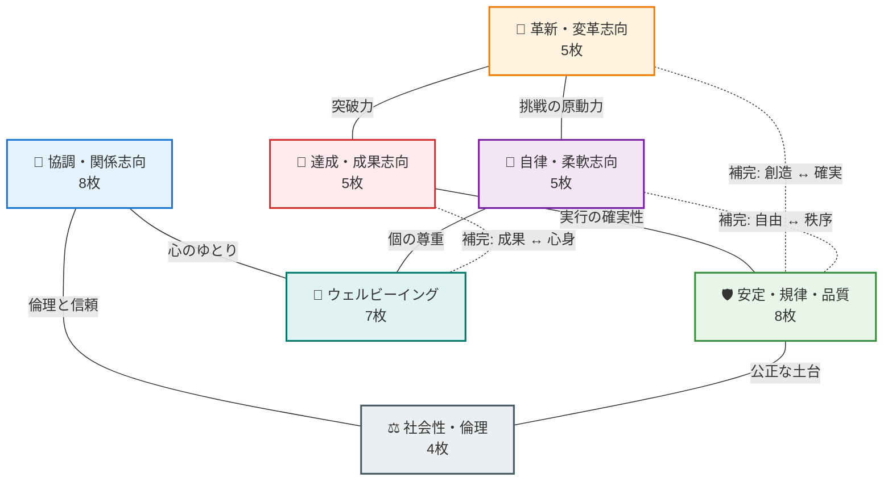

# Willoop 価値観42カード「7大志向性クラスタ＆2軸ポジショニングマップ」仕様書

本ドキュメントは、Willoopのバリュー診断で用いられる**全42枚の価値観カード**が「どのような志向性に属しているか」「組織文化・個人のカルチャーマップ上でどう位置づけられるか」を直感的に理解・可視化するための解説書です。

---

## 1. 2軸カルチャーポジショニングマップ（全体鳥瞰図）

組織論における「競合価値観フレームワーク（CVF）」および「Schwartzの文化的価値観理論」をベースに、42カードを以下の2つの基本軸上にプロットしています。

* **縦軸（アプローチ / 行動規範）**:
  * **【変革・挑戦・柔軟（上）】**: 変化を楽しむ、スピード、独創性、自由、新しい発想
  * **【安定・規律・着実（下）】**: 計画性、秩序、品質、誠実、持続可能性、ルール遵守
* **横軸（フォーカス / 価値の対象）**:
  * **【成果・タスク・事業（左）】**: 目標達成、効率、競争力、事業成長、当事者責任
  * **【人・関係・社会（右）】**: チームワーク、心理的安全性、感謝、ウェルビーイング、社会貢献

```
                            【変革・挑戦・柔軟（上）】
                                      ▲
                                      │
           【革新・変革志向 (5枚)】    │       【自律・柔軟志向 (5枚)】
           ・変革　・独創性　・夢中    │       ・自由　・広い視野　・本質志向
           ・好奇心　・主体性         │       ・自律　・信念
                                      │
    【達成・成果志向 (5枚)】          │       【ウェルビーイング志向 (7枚)】
    ・目標達成　・スピード            │       ・心身の充足　・自己受容
    ・効率　・一生懸命                │       ・ポジティブ　・多様性　・寛容
    ・ミスを取り戻す                  │       ・働きやすさ　・適度さ
                                      │
 ◀────────────────────────────────────┼────────────────────────────────────▶
 【成果・タスク・事業（左）】         │         【人・関係・社会（右）】
                                      │
    【安定・規律・品質志向 (8枚)】    │       【協調・関係志向 (8枚)】
    ・現実主義　・自責思考            │       ・質の高い対話　・愛　・協力
    ・計画性　・丁寧さ                │       ・感謝　・人の尊重　・信頼構築
    ・秩序　・上品さ                  │       ・顧客への思いやり　・情報共有
    ・誠実　・謙虚                    │
                                      │       【社会性・倫理志向 (4枚)】
                                      │       ・公平　・社会貢献
                                      │       ・社会的責任　・自然への配慮
                                      ▼
                            【安定・規律・着実（下）】
```

---

## 2. 7大志向性クラスタの完全所属一覧（全42カード）

各クラスタが象徴する「組織の空気感・個人のモチベーションの源泉」と、所属するカード一覧です。

### 1. 🚀 革新・変革志向（5枚 / オレンジ）
> **キーワード**: 「前例のない挑戦」「未知への熱量」「自ら動く」
> 現状維持を打破し、新しい価値やブレークスルーを生み出すことを最重要視するカルチャー。

| No | カード名 | 補足説明（動詞完了・簡潔な表現） | カルチャー・行動における意味合い |
| :---: | :--- | :--- | :--- |
| 1 | **変革** | 変革に取り組む | 既存の枠組みを疑い、新しい仕組みや変化を主導する |
| 2 | **独創性** | 独創的である | 人と同じであることを好まず、独自の視点やアイデアを重んじる |
| 3 | **好奇心** | 好奇心をもつ | 未知の知識や経験にワクワクし、進んで学び探究する |
| 4 | **主体性** | 主体性を持って推し進める | 指示を待たず、当事者として自らプロジェクトを牽引する |
| 5 | **夢中** | 仕事に夢中になる | 理屈や打算を超えて、対象に没頭し圧倒的な熱量を注ぐ |

---

### 2. 🎯 達成・成果志向（5枚 / レッド）
> **キーワード**: 「コミットメント」「迅速なアウトプット」「高い目標」
> 目標に対する徹底したこだわりとスピード感を持ち、目に見える事業成果を追求するカルチャー。

| No | カード名 | 補足説明（動詞完了・簡潔な表現） | カルチャー・行動における意味合い |
| :---: | :--- | :--- | :--- |
| 6 | **目標達成** | 目標・目的を達成する | 定めたゴールに対する強い執着と実行力を持つ |
| 7 | **スピード** | スピード感を持つ | 完璧を待たず即座に行動に移し、市場・顧客の期待に応える |
| 8 | **効率** | 効率を重視する | 無駄な作業やコストを徹底的に削ぎ落とし、生産性を最大化する |
| 9 | **一生懸命** | 何事にも一生懸命で全力を尽くす | どんな困難な局面でも逃げず、愚直にエネルギーを注ぎ切る |
| 10 | **ミスを取り戻す** | ミスをしても取り戻す | 失敗に立ち止まらず、迅速なリカバリーで信頼を取り戻すリジリエンス |

---

### 3. 🤝 協調・関係志向（8枚 / ブルー）
> **キーワード**: 「心理的安全性」「相互リスペクト」「顧客・仲間ファースト」
> 関わるすべてのステークホルダー（仲間・顧客・パートナー）との絆と温かい信頼関係を重んじるカルチャー。

| No | カード名 | 補足説明（動詞完了・簡潔な表現） | カルチャー・行動における意味合い |
| :---: | :--- | :--- | :--- |
| 11 | **人の尊重** | 人を大切にする | メンバーや関わる一人ひとりの人格や尊厳を最優先する |
| 12 | **信頼構築** | 信頼関係を構築する | 口先だけでなく約束を守り、強固な信義を築き上げる |
| 13 | **感謝** | 感謝を伝える | 日常の当たり前の中にありがたさを見出し、言葉にして届ける |
| 14 | **協力** | 他者と協力する | 個人のスタンドプレーではなく、チーム全体の相乗効果を重んじる |
| 15 | **質の高い対話** | 質の高いコミュニケーションをする | 表面的な雑談にとどまらず、本音や背景を汲み取る深い対話を行う |
| 16 | **顧客への思いやり** | 顧客への思いやりをもつ | 顧客の痛みに寄り添い、期待を超えるホスピタリティを提供する |
| 17 | **愛** | 愛を持って仕事をする | チームやサービス、利用者に対して無私の愛情と敬意を注ぐ |
| 18 | **情報共有** | 情報を適切に共有する | 属人化を防ぎ、チーム全員が同じ視界で動ける透明性を保つ |

---

### 4. 🦅 自律・柔軟志向（5枚 / パープル）
> **キーワード**: 「裁量と自律」「本質の探究」「大局的な視野」
> 細かなルールに縛られず、大局観と個人の信念に基づいて自律的に動くプロフェッショナルカルチャー。

| No | カード名 | 補足説明（動詞完了・簡潔な表現） | カルチャー・行動における意味合い |
| :---: | :--- | :--- | :--- |
| 19 | **自由** | 自由に働く | 場所や時間、手法の裁量を持ち、伸び伸びと能力を発揮する |
| 20 | **自律** | 自分を律して管理する | 誰かに管理されなくても、高い基準で自己をコントロールする |
| 21 | **信念** | 自分の信念に基づいて行動する | 外部の圧力や流行に流されず、自分の価値基準・美学を貫く |
| 22 | **本質志向** | 本質志向である | 「そもそも何のためか」を問い続け、枝葉末節にとらわれない |
| 23 | **広い視野** | 広い視野を持つ | 目の前の業務だけでなく、事業全体や業界・将来を見据えて判断する |

---

### 5. 🛡️ 安定・規律・品質志向（8枚 / グリーン）
> **キーワード**: 「確実な完遂」「高い再現性」「インテグリティ」
> 約束を守り、手堅い計画と緻密な仕事でサービスの品質と組織の信頼性を守り抜く守護神カルチャー。

| No | カード名 | 補足説明（動詞完了・簡潔な表現） | カルチャー・行動における意味合い |
| :---: | :--- | :--- | :--- |
| 24 | **計画性** | 計画的に進める | 見通しを立て、リスクを想定しながら着実に進行する |
| 25 | **秩序** | 秩序を守る | 組織のルールや手順、コンプライアンスを遵守し崩壊を防ぐ |
| 26 | **丁寧さ** | 丁寧に仕事をする | 細部にまで心を配り、妥協のない高品質なアウトプットを届ける |
| 27 | **誠実** | 誠実でいる | 嘘やごまかしがなく、誰に対しても真摯で裏表のない対応をする |
| 28 | **上品さ** | 上品に振る舞う | 礼儀正しく節度ある言動で、周囲に安心感と品格を与える |
| 29 | **現実主義** | 現実主義である | 理想論に逃げず、ファクトと数字に基づいた冷静な判断を下す |
| 30 | **自責思考** | 自責思考である | 他人や環境のせいにせず、自分が変えられることにフォーカスする |
| 31 | **謙虚** | 謙虚でいる | 成果が出ても奢らず、周囲への感謝と自己研鑽の姿勢を忘れない |

---

### 6. 🌱 ウェルビーイング志向（7枚 / ティール）
> **キーワード**: 「持続可能性」「心理的安心」「自分らしさ」
> 無理な根性論を廃し、心身の健康と多様性を尊重しながら、いきいきと長く働き続けられるカルチャー。

| No | カード名 | 補足説明（動詞完了・簡潔な表現） | カルチャー・行動における意味合い |
| :---: | :--- | :--- | :--- |
| 32 | **働きやすさ** | 働きやすい職場である | 職場環境や制度を整え、誰もがストレスなく業務に集中できる場を作る |
| 33 | **心身の充足** | 心身が満たされている | 心と体の健康を保ち、プライベートと仕事の充実を両立する |
| 34 | **自己受容** | 自己受容している | 完璧を求めすぎず、自分の弱みや現状をありのまま認める |
| 35 | **適度さ** | 適度にする | バーンアウトを防ぎ、長期的な持続可能性を保つバランス感覚 |
| 36 | **寛容** | 寛容である | 他者のミスや違いを咎めず、広い心で包容する |
| 37 | **多様性** | 多様性を尊重する | 性別・経歴・価値観の違いを歓迎し、多様な視点を活かす |
| 38 | **ポジティブ** | ポジティブでいる | 困難な状況でも明るい面を見出し、前向きな空気をチームに生む |

---

### 7. ⚖️ 社会性・倫理志向（4枚 / スレート）
> **キーワード**: 「公器としての組織」「フェアネス」「未来世代への責任」
> 自社の利益だけでなく、社会全体や地球環境への貢献と公正さを重んじるパブリックマインドカルチャー。

| No | カード名 | 補足説明（動詞完了・簡潔な表現） | カルチャー・行動における意味合い |
| :---: | :--- | :--- | :--- |
| 39 | **社会貢献** | 社会へ貢献する | 事業を通じて社会課題を解決し、より良い世の中を創る |
| 40 | **社会的責任** | 社会への責任を果たす | 法令遵守にとどまらず、企業の社会的責任（CSR）を果たす |
| 41 | **公平** | フェアである | えこひいきや偏見を排除し、透明で納得感のある判断を行う |
| 42 | **自然への配慮** | 自然に配慮をする | 地球環境や持続可能な生態系への負荷を最小限に抑える |

---

## 3. マッチング・組織診断における相関・ダイナミクス

7つの志向性は独立しているだけでなく、互いに**「親和的な関係（同質）」**や**「相互補完・トレードオフの関係（補完・緊張）」**を持ちます。



### マッチング解説における活用例
1. **同質フィット（共鳴）**:
   - 例: 企業が「協調・関係志向（人の尊重・感謝）」を重視 $\times$ 学生が「ウェルビーイング志向（心身の充足・寛容）」を重視
   - $\rightarrow$ 「お互いを認め合い、安心して働ける最高のカルチャーフィット」として解説。
2. **補完フィット（突破口・要）**:
   - 例: 企業が「協調・ウェルビーイング型（穏やか・調和）」 $\times$ 学生が「革新・変革志向（変革・主体性）」を重視
   - $\rightarrow$ 「温かいチームの良さを保ちながら、停滞を打ち破る推進エンジンになる補完フィット」として解説。
