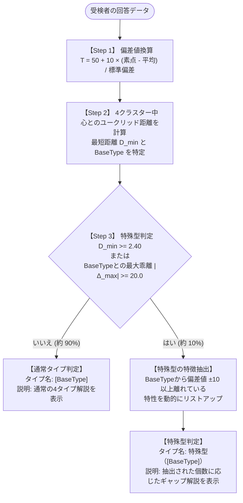

# パーソナリティフィット実装計画書

## 1. 尺度項目と測定定義

社交性、好奇心、不安耐性、着実性の４つの特性で性格を計測する。

| 逆転項目 | 特性 | 質問項目 |
| :---: | :--- | :--- |
| | 社交性 | 周囲が緊張せずに過ごせるよう意識する。 |
| | 社交性 | 一緒に働く人たちがどんな人なのか、興味がある。 |
| | 社交性 | 職場の人が今どんな気分でいるかを敏感に察する。 |
| | 社交性 | メンバーとの雑談は、自分の方から会話を始めることが多い。 |
| | 社交性 | 誰かとコミュニケーションを取りながら仕事を進めるのが好きだ。 |
| | 社交性 | 初めて一緒に働く人とも、すぐに仲良くなれる。 |
| | 社交性 | 同僚が困っていないか、いつもさりげなく気にしている。 |
| | 社交性 | 同僚の喜びや悲しみに、自分のことのように共感する。 |
| | 好奇心 | 戦略を立てるなどの考える仕事が面白いと感じる。 |
| | 好奇心 | 創造性を求められる仕事がしたい。 |
| | 好奇心 | 会社を改善する新しいアイデアを想像することが好きだ。 |
| | 好奇心 | 今までにやったことのない仕事をするとき、ワクワクする。 |
| | 好奇心 | 決められたことを毎日繰り返すような仕事は、すぐに飽きてしまう。 |
| ー | 好奇心 | 自分の仕事がどのような意義があるかを考えることは滅多にない。 |
| ー | 不安耐性 | 仕事上の小さな自分のミスで、すぐに動揺してしまう。 |
| ー | 不安耐性 | 仕事上の些細な指摘にひどく落ち込んでしまうことが多い。 |
| ー | 不安耐性 | 自分の行った仕事に不安を感じることが多い。 |
| ー | 不安耐性 | 仕事で予想外のアクシデントがあると、頭が真っ白になりやすい。 |
| | 不安耐性 | 仕事で予期せぬ変更が生じても、落ち着いていられる。 |
| | 不安耐性 | 締め切りの間際などプレッシャーのかかる場面でも、冷静さを保てる。 |
| | 着実性 | 計画に沿って仕事を進めるほうだ。 |
| | 着実性 | 期限までに与えられた業務を終わらせる。 |
| ー | 着実性 | 未完成の仕事を中途半端に放置してしまうことがよくある。 |
| | 着実性 | 使った道具や書類は、元の場所にきちんと戻すのが習慣だ。 |
| ー | 着実性 | ついつい期限を軽く考えてしまう。 |
| | 着実性 | 細かなタスクは、後回しにせずすぐに片付ける。 |
| | 着実性 | 物事に取りかかる前に、まずは計画を立てるほうだ。 |
| | 着実性 | 仕事の細部まで確認しないと気が済まない。 |

---

## 2. 基礎統計パラメータ

### ① 各尺度の母集団パラメータ（素点基準）
| 特性 | FAC | 平均 | 標準偏差 ($\\sigma$) |
| :--- | :---: | :---: | :---: |
| **社交性** | FAC1 | 3.257015 | 0.7915005 |
| **好奇心** | FAC2 | 3.302721 | 0.8653991 |
| **不安耐性** | FAC3 | 2.854592 | 0.7046661 |
| **着実性** | FAC4 | 3.437500 | 0.4978318 |

### ② 4つの基本クラスター中心値
| クラスター名 | 社交性 (FAC1) | 好奇心 (FAC2) | 不安耐性 (FAC3) | 着実性 (FAC4) |
| :--- | :---: | :---: | :---: | :---: |
| **自分のペースで着実に進める安定タイプ** | 2.946078 (46.1) | 2.784314 (44.0) | 3.284314 (56.1) | 3.311275 (47.5) |
| **計画的に丁寧に積み上げる慎重タイプ** | 2.411111 (39.3) | 2.444444 (40.1) | 2.203705 (40.8) | 3.430556 (49.9) |
| **自由な発想で変化を楽しむ巻き込みタイプ** | 3.864362 (57.7) | 3.851064 (56.3) | 2.567376 (45.9) | 3.050532 (42.2) |
| **周囲を牽引し構想を現実する推進タイプ** | 3.735849 (56.0) | 4.044025 (58.6) | 3.248428 (55.6) | 3.908019 (59.5) |

※カッコ内は偏差値換算値（平均50、標準偏差10）。

---

## 3. パーソナリティタイプ判定ロジック（最新確定仕様）

### ① 設計思想
- **4タイプのシンプルさを維持**: 基本分類は「推進」「慎重」「巻き込み」「安定」の4タイプを維持する。
- **学術的合意（高原教授助言）の反映**:
  1. 簡便な素点計算から「偏差値換算空間でのユークリッド距離」へ移行。
  2. 当てはまりが弱い上位約10%の受検者を「特殊型」として定義。
  3. 特殊型は「一番近いクラスター（BaseType）」を基点とし、そこからの差分（ギャップ）を説明する。
- **動的ギャップ抽出**: 乖離項目が1つ、2つ（社員Aなど）、3つのいずれであっても、自然な説明文を自動合成する。

---

### ② 判定フロー図



---

### ③ 数理判定式

1. **偏差値換算式**:
   $$ T_i = 50 + 10 \\times \\frac{X_i - \\mu_i}{\\sigma_i} \\quad (i \\in \\{1, 2, 3, 4\\}) $$
2. **クラスター間ユークリッド距離（Zスコア空間）**:
   $$ D_c = \\sqrt{ \\sum_{i=1}^{4} \\left( \\frac{T_i - C_{c,i}}{10} \\right)^2 } $$
   - 最短距離を $D_{min} = \\min_{c} D_c$、該当クラスターを $\\text{BaseType}$ とする。
3. **特殊型判定基準（上位約10%）**:
   $$ \\text{特殊型判定} \\iff (D_{min} \\ge 2.40) \\quad \\text{OR} \\quad (\\max_{i} |T_i - C_{\\text{BaseType},i}| \\ge 20.0) $$
   - **$D_{min} \\ge 2.40$**: 4次元空間における全体的外れ値（約7.5%）
   - **$|\\Delta| \\ge 20.0$**: 1項目のみ真逆・突出している外れ値（約2.5%）を救済するセーフティネット
   - **合計発生率**: 母集団の約 **9.8% 〜 10.4%**（約10人に1人）

---

### ④ 特殊型の特徴（ギャップ）抽出ルール
BaseTypeの中心値から **偏差値 $\\pm 10$（$1.0\\sigma$）以上** 離れている特性を動的に抽出：
- $+10$ 以上 $\\rightarrow$ **「◯◯が突出して高い」**
- $-10$ 以上 $\\rightarrow$ **「◯◯が控えめ」**（不安耐性の場合は「**プレッシャーに繊細に向き合う**」）

#### ギャップ個数に応じた自動合成ルール:
- **1項目の場合 (約30%)**: 「全般的な資質は【BaseType】に近いですが、特に【[項目]が突出/控えめ】という際立った特徴を持っています。」
- **2項目の場合 (約43%・社員Aなど最多)**: 「全般的な資質は【BaseType】に近いですが、【[項目1]】、かつ【[項目2]】という二面性の個性を持っています。」
- **3項目以上の場合 (約23%)**: 「全般的な資質は【BaseType】に近いですが、【[項目1]・[項目2]】、かつ【[項目3]】という多面的な個性を持っています。」

---

## 4. 診断結果の出力例

### ① 通常タイプ判定例（約90%）
- **受検者得点**: 社交 55, 好奇 58, 不安 54, 着実 61（$D_{min} = 0.28 < 2.40$）
- **表示名**: **推進タイプ**
- **解説文**: 「高い行動力と強い意志で目標を掲げ、周囲をリードして大きな成果を実現するリーダータイプです。」

### ② 特殊型・二面性タイプ判定例（社員A / 約4.5%）
- **受検者得点**: 社交 48, 好奇 58, **不安 38（低い）**, **着実 74（超高い）**（$D_{min} = 2.42 \\ge 2.40$）
- **表示名**: **特殊型（推進タイプ）**
- **解説文**: 「全般的な資質は【推進タイプ】に近いですが、一般的な推進タイプに比べて【着実性が突出して高く】、かつ【プレッシャーに対して繊細に向き合う】という二面性の個性を持っています。無鉄砲に引っ張るのではなく、石橋を叩いて確実に渡る『緻密な計画性とミスのない完全遂行力』で組織の目標を着実に実現させる計画推進役として最大の強みを発揮します。」

---

## 5. マッチ度・組織フィット算出式

### ① 標準化と経年管理
その時点で蓄積されている全データを元に標準化を行うのが適切。基準が毎度変わるのを防ぐため、1年ごとに基準となる平均と標準偏差を算出して固定利用する。経年調査時はデータを追加するのではなく差し替えることが望ましい。

### ② 個人とグループ（チーム）のマッチ度
1. 4尺度ごとに、本人の平均値（$= A$）を求める。
2. 4尺度ごとに、本人以外のグループ平均値（$= B$）を求める。
3. $A$ と $B$ をそれぞれ標準化させる。
4. 4尺度の差分2乗和の平方根を算出し、マッチ指標とする（指標が低いほどマッチ度が高い）。
   ※少人数補正: グループ人数が少ない場合の補正として $\\sqrt{n / (n-1)}$ を乗じる手法があるが、算出ロジックの平易さを優先し、補正なしで注記対応とする。

### ③ 簡易版マッチ得点（フィット率％）
4因子（各1〜5段階）における理論上の最大乖離距離は $\\sqrt{4^2 \\times 4} = 8$。
$$ \\text{フィット率（％）} = \\left( 1 - \\frac{\\text{実際のユークリッド距離}}{8} \\right) \\times 100 $$
（例: ユークリッド距離が 1.082 の場合、フィット率は約 86.5%）

---

## 6. システム実装用リファレンスコード (Python)

```python
import math

CLUSTERS = {
    '推進タイプ': {'name': '推進タイプ', 't': [56.0, 58.6, 55.6, 59.5], 'desc': '高い行動力と強い意志で目標を掲げ、周囲をリードして大きな成果を実現するリーダータイプです。'},
    '慎重タイプ': {'name': '慎重タイプ', 't': [39.3, 40.1, 40.8, 49.9], 'desc': 'リスクを想定し、細部まで入念に確認しながらミスのない確実な成果を追求する品質重視タイプです。'},
    '巻き込みタイプ': {'name': '巻き込みタイプ', 't': [57.7, 56.3, 45.9, 42.2], 'desc': '高い社交性とアイデアで周囲を巻き込み、新しい変化や挑戦を積極的に楽しむムードメーカータイプです。'},
    '安定タイプ': {'name': '安定タイプ', 't': [46.1, 44.0, 56.1, 47.5], 'desc': '周囲と調和を保ちながら、自分のペースで落ち着いて堅実に業務を前進させるバランサータイプです。'}
}
TRAIT_NAMES = ['社交性', '好奇心', '不安耐性', '着実性']

def diagnose_personality(user_tscores, T_dist=2.40, M_dev=20.0):
    """
    受検者の偏差値リスト [社交性, 好奇心, 不安耐性, 着実性] からパーソナリティタイプを判定する
    """
    # 1. 4クラスター中心とのユークリッド距離を計算
    dist_list = []
    for c_id, c_info in CLUSTERS.items():
        diffs = [user_tscores[i] - c_info['t'][i] for i in range(4)]
        d = math.sqrt(sum((diff / 10.0) ** 2 for diff in diffs))
        dist_list.append((d, c_id, c_info, diffs))
    
    # 2. 最短距離クラスター（BaseType）を特定
    dist_list.sort(key=lambda x: x[0])
    min_dist, base_id, base_info, diffs = dist_list[0]
    max_dev = max(abs(x) for x in diffs)
    
    # 3. 通常タイプ判定（全体の約90%）
    if min_dist < T_dist and max_dev < M_dev:
        return {
            'type_name': base_info['name'],
            'is_special': False,
            'base_type': base_id,
            'distance': round(min_dist, 2),
            'explanation': base_info['desc']
        }
    
    # 4. 特殊型判定（全体の約10%）：偏差値 ±10 以上の乖離特性を抽出
    features = []
    for i in range(4):
        diff = diffs[i]
        if diff >= 10.0:
            features.append(f"【{TRAIT_NAMES[i]}が突出して高い】")
        elif diff <= -10.0:
            if i == 2:  # 不安耐性
                features.append("【プレッシャーに対して繊細に向き合う】")
            else:
                features.append(f"【{TRAIT_NAMES[i]}が控えめ】")
                
    if len(features) == 1:
        feature_text = f"特に{features[0]}という際立った特徴"
    elif len(features) == 2:
        feature_text = f"{features[0]}、かつ{features[1]}という二面性の個性"
    elif len(features) >= 3:
        feature_text = f"{'・'.join(features)}という多面的な個性"
    else:
        feature_text = "複数の強みを併せ持ったユニークな個性"
        
    explanation = (
        f"全般的な資質は【{base_id}】に近いですが、一般的な{base_id}に比べて"
        f"{feature_text}を持っています。"
    )
    
    return {
        'type_name': f"特殊型（{base_id}）",
        'is_special': True,
        'base_type': base_id,
        'distance': round(min_dist, 2),
        'max_dev': round(max_dev, 1),
        'features': features,
        'explanation': explanation
    }
```

---

## 7. 実運用データによる妥当性検証と今後の運用方針（2026年10月 高原教授検証）

2026年10月に蓄積された実運用データ（計311名分）に基づき、大阪経済大学 高原龍二教授によって実施された測定尺度の安定性およびクラスター分析の再検証結果と、今後の運用方針です。

### ① 検証概要
- **対象データ**: Willoop診断 本番実データ 311名分（学生・求職者 91名、既存社員 220名 / 欠損値なし）
- **検証者**: 大阪経済大学 経営学部 高原龍二 教授（2026年10月30日実施）
- **参照データ**: `高原教授_分析結果_result.xlsx`（シート1: 因子分析 / シート2: クラスター分析）

### ② 因子分析（測定尺度の安定性）の検証結果
- **結論: 尺度の妥当性を確認（ほぼ一致）**
  - 予備調査データと実データの因子負荷構造を比較した結果、探索的因子分析において4因子（社交性・好奇心・不安耐性・着実性）の構造は**ほぼ一致**し、測定尺度としての安定性が実証された。
- **今後の項目見直し（削除候補）**:
  - 好奇心の逆転項目である**「自分の仕事がどのような意義があるかを考えることは滅多にない（P14）」**のみが主因子とは別の因子に負荷する傾向が見られた。
  - 今後さらにデータが集積された段階で、尺度の信頼性向上のための**削除・差し替え候補**として検討する。

### ③ クラスター分析（タイプ分類）の検証結果
- **クラスター数の妥当性**:
  - $k = 2 \sim 5$ のクラスター抽出を実施・比較した結果、300名規模のデータにおいても**「4クラスター」の採用が妥当**であることを確認。
- **クラスター構造の比較**:
  - 今回の実データから抽出された4クラスターのうち、クラスター1・2は予備調査のクラスター3・4に近い傾向を示したものの、クラスター3・4は予備調査のクラスター1・2と完全には対応していない。
  - これは300名規模のサンプルでは母集団の揺らぎや標本特性（学生・若手比率等）の影響を受けやすく、クラスター境界が未だ流動的であることを示している。

### ④ 今後の運用方針（高原教授の助言）
> [!IMPORTANT]
> **「急いでクラスター数や集計方法（中心値）は変更せず、現行の4タイプ仕様を継続維持する」**
> - **理由**:
>   1. 現行ロジックに基づくイベント実証（ASOBIBA FES等）において、マッチングを有意に押し上げる顕著な成果が既に確認されている。
>   2. 300名程度の規模で中心値や算出ロジックを頻繁に変更すると、診断結果の経年比較性・安定性が損なわれるリスクがある。
>   3. さらなるデータ集積（1,000名規模等）を待ってから、確認的因子分析および多母集団同時分析を行い、安定したタイミングで必要に応じた中心値の再キャリブレーションを行う。

### ⑤ 実証イベント（ASOBIBA FES）分析結果と今後の発展
- **マッチング実証の成果**:
  - 企業のネームバリューや時間経過を統制した多変量ロジスティック回帰において、バリューフィット度（OR 1.651, $p < 0.01$）、パーソナリティフィット度（OR 1.723, $p < 0.01$）ともにマッチング成立を有意に押し上げることが実証された。
- **学術的深掘り・論文化に向けた助言**:
  - 企業と個人のネスト構造に対応した **マルチレベルモデル（階層線形モデル）** の適用
  - 「知りたい度（なし・知りたい・めっちゃ知りたい）」の3段階データに対する **順序ロジスティック回帰** の適用
  - パーソナリティ4尺度それぞれの距離ベクトルを用いた相性パターンの深掘り分析
